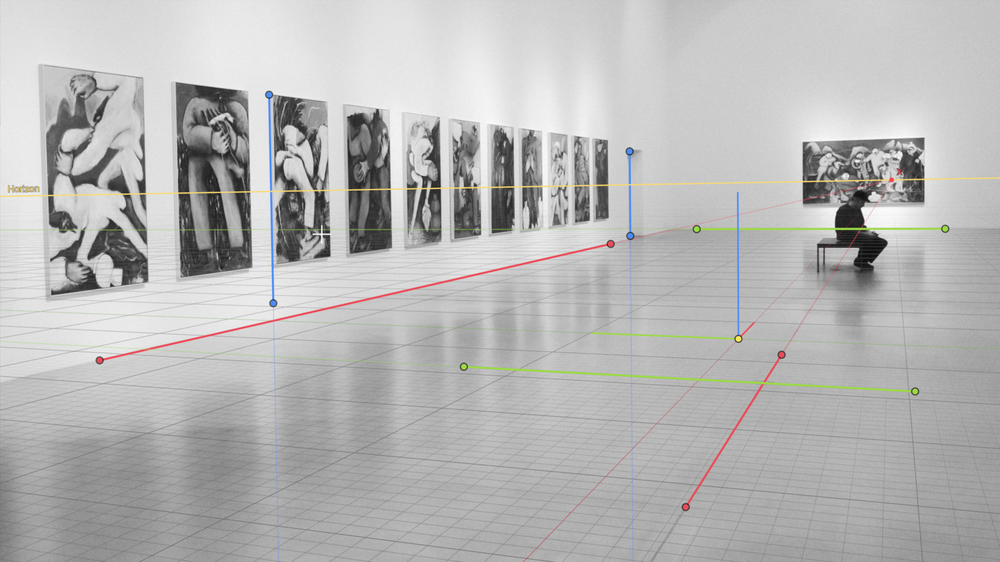

# Perspective Match

A Blender extension that matches a camera to a photo. You draw perspective
lines along edges in the photo (or let **Detect Lines** find them), the
vanishing points come from the lines, and the camera is solved from them —
live, in the camera view, while you drag.

Everything happens inside Blender and the camera stays editable: turn or move
the camera by hand and the lines follow it; drag the lines and the camera
follows them.

* Blender 5.2 or newer (tested on 5.2.1, macOS, Apple Metal)
* License: GPL-3.0-or-later
* No external dependencies

## Install

* From Blender: **Edit ▸ Preferences ▸ Get Extensions**, search for
  *Perspective Match* (once it is published on extensions.blender.org).
* Or download the zip from the
  [Releases](../../releases) page and use **Install from Disk…** in the same
  menu.

## Quick start

1. Open the Sidebar in the 3D Viewport (**N**) ▸ **Perspective** tab.
2. Click **+** next to the Camera field and pick a photo. A new camera gets the
   photo as its background, the render size is set to the photo size, and
   **Edit Perspective** starts.
3. Click **Detect Lines** — or drag the ends of the lines onto edges in the
   photo that run along the world X, Y and Z axes yourself.
4. Drag the origin point to where the world origin should be.
5. Optional: open **Scale**, tick **Specify Scale** and drag the end of the
   measuring line to the end of something of known length.

Tab or Esc leaves Edit Perspective. Each edit is one undo step.

## Modes

| Mode | Use it for | What it does |
|---|---|---|
| **2 Points** | most photos: two horizontal directions, or one horizontal and the verticals | two vanishing points give the rotation and the focal length |
| **3 Points** | strong vertical convergence (looking up or down at buildings) | three vanishing points give the rotation, the focal length and the shift |
| **Parallel Verticals** | photos and renders with corrected verticals: shot with a shift / tilt-shift lens, straightened in an editor, or rendered with shift instead of tilting the camera | no tilt or roll (Rotation X 90°, Y 0°), so vertical lines stay vertical; the X and Y lines give the turn left / right, the focal length and Shift Y |
| **1 Point** | corridors, streets: one vanishing point | one vanishing point turns the camera; the focal length is kept |

## Features

* **Live editing that feels like Blender**: select, box select, move / rotate
  / scale points with your familiar Blender shortcuts, axis constraints, Shift for precision,
  snapping to other points with the scene snapping toggle (Ctrl inverts it).
  Viewport navigation is never captured.
* **Detect Lines** finds straight edges on the photo, chooses the mode itself
  and places two lines per direction (easy to adjust by hand). When the photo
  does not give a reliable camera it changes nothing and says why.
* **Specify Scale**: a known length along an axis from the origin sets the
  size of the world; the photo does not change.
* **Extra lines** per direction for photos with many short edges (tiles,
  windows, bricks): all of them are used (least squares).
* **Principal point** (lens shift) can be dragged where the mode allows it.
* **Reset Camera Position** puts the camera at a standard place (1.6 m above
  the ground, origin on the floor) without changing the view.
* Everything is stored on the camera in the .blend file: the photo is the
  camera's background image, the lines live on the camera data. Several
  cameras can each have their own match.

### How good is Detect Lines?

On the [York Urban Database](https://www.elderlab.yorku.ca/resources/york-urban-line-segment-database-information/)
(102 photos with a calibrated camera and known directions) it answers on 84
and refuses on 18. Of the answers, 98 % have the camera's directions within
5° (median error 1.2°) and the median focal length error is 3.4 %.
It needs straight edges in at least two perpendicular directions; strong lens
distortion, curved architecture or photos with only one clear direction lead
to a refusal rather than a wrong camera. The lines can always be adjusted by
hand afterwards.

## Credits

* The camera solving maths is a port of the solver of
  [fSpy](https://github.com/stuffmatic/fSpy) by Per Gantelius (GPL-3.0), which
  is based on Guillou, Meneveaux, Maisel, Bouatouch, *Using Vanishing Points
  for Camera Calibration and Coarse 3D Reconstruction from a Single Image*
  (2000). The Blender camera mapping follows the
  [fSpy importer for Blender](https://github.com/stuffmatic/fSpy-Blender).
* Built with [Claude](https://claude.ai) (Anthropic) as the coding assistant:
  the author set the goals and the design and tested everything in Blender;
  Claude wrote the code, the tests and the documentation.
* Detect Lines was evaluated on the York Urban Database (Denis, Elder,
  Estrada, ECCV 2008); the database is not included.

## For developers

See [`AGENTS.md`](AGENTS.md) (architecture, rules, how to test and build — it
is also the entry point for AI coding assistants), [`docs/DESIGN.md`](docs/DESIGN.md)
(why things work the way they do) and [`docs/MATH.md`](docs/MATH.md)
(coordinate frames and the maths).

## License

GPL-3.0-or-later. See [`LICENSE`](LICENSE).
